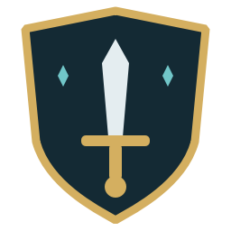
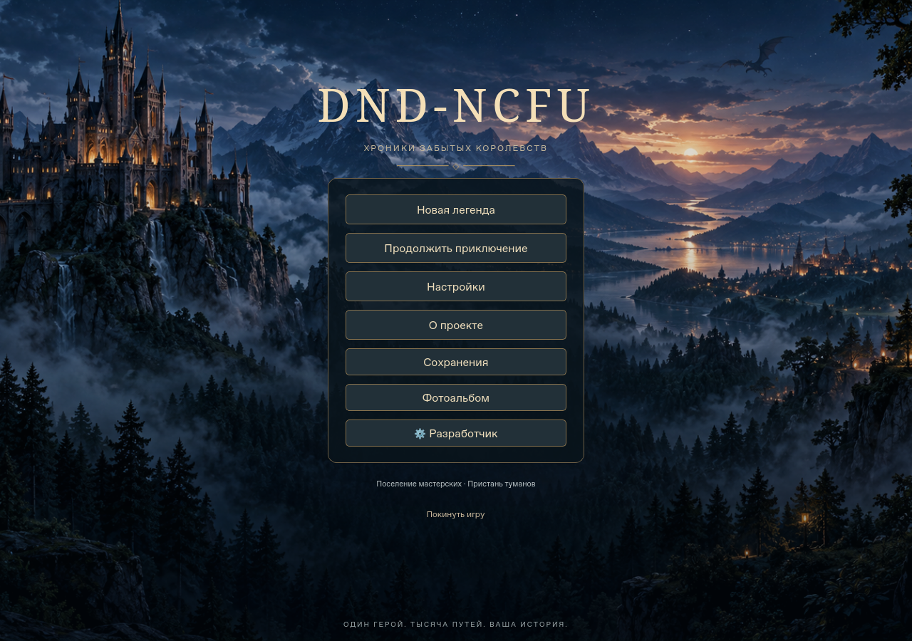
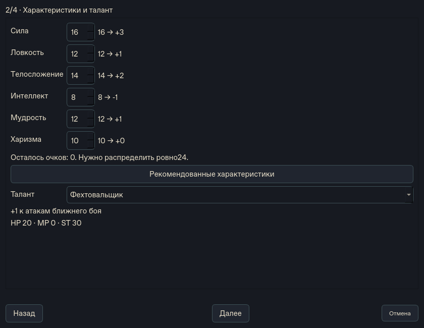

# DND-NCFU — Хроники забытых королевств

Текстовая фэнтезийная RPG для Windows с ИИ-мастером, свободными действиями
и сохраняемым игровым миром. Мастер предлагает события и рассказывает историю;
движок проверяет действия, бросает кубики и рассчитывает последствия.

**Статус: предварительное тестирование.** Код 0.4.0 развивается в
`feature/unified-rpg-automatic-gm`. Стабильный выпуск ещё не опубликован.

## Что можно делать

- Создать Воина, Лучника, Плута, Мага, Жреца или Ремесленника: выбрать
  характеристики и талант, описать прошлое героя и пожелания к миру.
- Исследовать мир, разговаривать с NPC и предлагать свободные действия мастеру.
- Развивать героя, сражаться, применять магию с расходом MP и бросать D4–D100.
- Менять оружие и броню, производить и ремонтировать предметы, заниматься
  алхимией и торговлей с конечными запасами товаров и денег.
- Следить за временем, потребностями, событиями и отношениями фракций.
- Сохранять кампанию и продолжать её; старые сохранения используют свои правила.

RouterAI подключает DeepSeek. Мастер автоматически получает релевантные выдержки
из 19000 подготовленных справочных карточек. Это поиск по базе, а не обучение модели.
Симуляция мира ограничена реализованными механиками; собственных обученных весов нет.

[Галерея интерфейса](docs/screenshots/README.md) · [Правила](docs/unified/ruleset.md) ·
[Ограничения](docs/known-limitations.md)

## Скачать для Windows x64

[**Опубликованные предварительные выпуски и Setup**](https://github.com/sayferst/DND-NCFU/releases)

Последний опубликованный выпуск —
[0.3.1 Preview2](https://github.com/sayferst/DND-NCFU/releases/tag/v0.3.1-preview.2).
Он исторический и не содержит всех возможностей 0.4.0, показанных выше.
**Текущий тестерский Setup0.4.0 пока выдаёт владелец; публичный Release готовится.**
Временные CI-артефакты не используются здесь как постоянная ссылка скачивания.

Тестировщику нужны Windows x64, интернет, выданный профиль и работающий хост
владельца. Python, Git, Ollama и ML-библиотеки устанавливать не требуется.

1. Получите актуальный Setup и профиль у владельца.
2. Установите приложение и запустите DND-NCFU.
3. Войдите в выданный профиль, создайте героя и начните приключение.

[Установка и первый запуск](docs/tester-guide.md) · [Решение проблем](docs/troubleshooting.md)

## Как пользоваться программой и играть

[**Открыть пошаговый гайд игрока**](docs/player-guide.md)

Первый запуск, создание героя, разделы интерфейса, примеры сообщений мастеру,
кубики и ресурсы, бой, магия, ремесло, торговля, путешествия и сохранение кампании.
Начните с раздела «Первые десять минут» — он рассчитан на первую игру.

[Готовые тексты героя и мира для тестовой игры](docs/examples/README.md) —
шесть пар примеров, которые можно скопировать в конструктор.

## Как устроена игра

Игрок описывает действие → мастер предлагает команду → движок проверяет её
и рассчитывает исход → мастер описывает подтверждённый результат → состояние
и события сохраняются. Важные действия могут требовать подтверждения игрока.
Текст модели не может самостоятельно выдать предметы или изменить SQLite.

Python 3.12 · PySide6 · SQLite · RouterAI/DeepSeek · авторские правила D20 ·
GitHub Actions · PyInstaller · Inno Setup.

## Разработка и поддержка

[Документация](docs/README.md) · [Разработчику](docs/development.md) ·
[Владельцу хоста](docs/owner-guide.md) · [История версий](CHANGELOG.md) ·
[Сообщить об ошибке](https://github.com/sayferst/DND-NCFU/issues/new/choose)

По решению владельца авторский код пока распространяется без открытой лицензии.
Сторонние компоненты и материалы SRD 5.2.1 CC BY 4.0 перечислены в
[уведомлениях и атрибуции](LICENSES_AND_ATTRIBUTIONS.md). Собственные механики
не объявляются полной реализацией D&D. Проект поддерживается в репозитории
[sayferst/DND-NCFU](https://github.com/sayferst/DND-NCFU).
