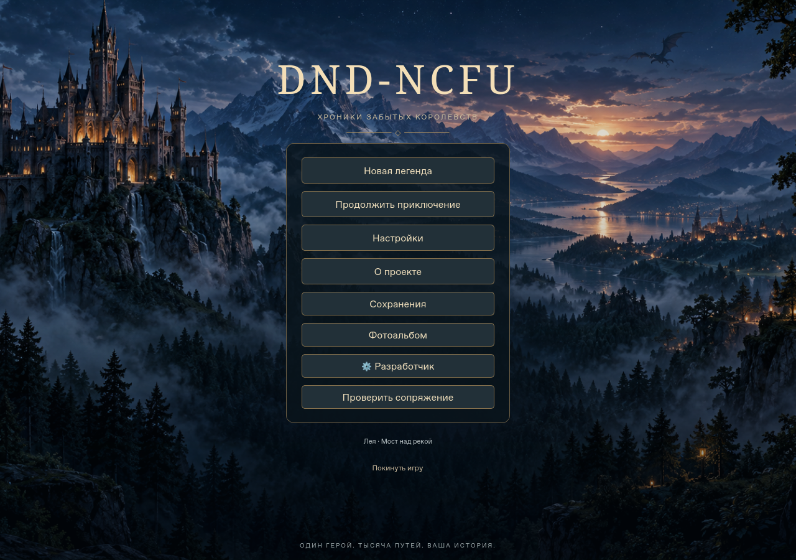
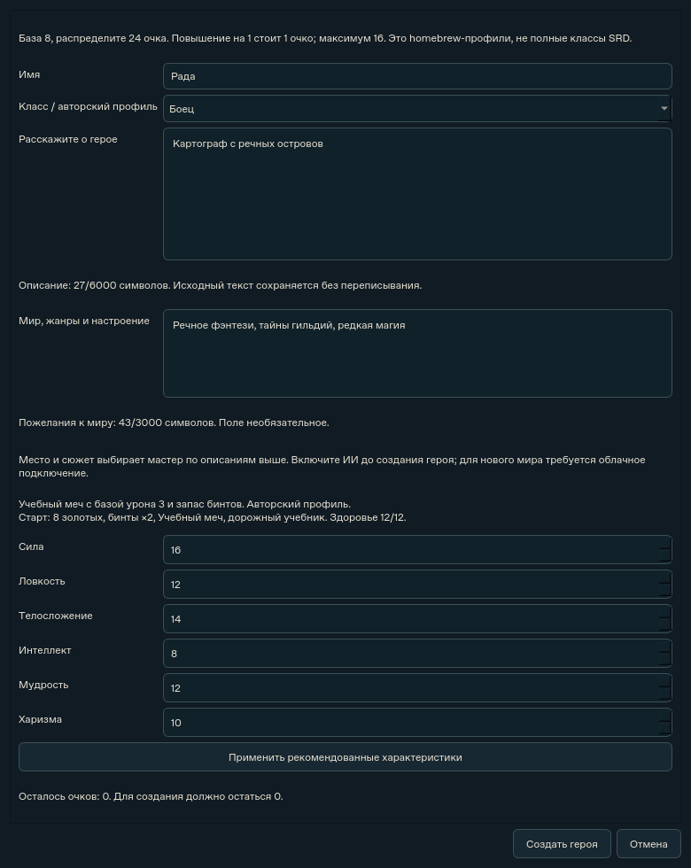
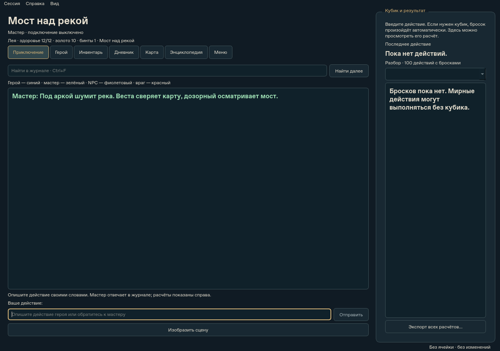

# DND-NCFU — Хроники забытых королевств

Настольная текстовая фэнтезийная RPG с графическим интерфейсом и ИИ-мастером.
Проект разрабатывается в рамках ВКР: модель предлагает повествование и действия,
а игровой движок проверяет правила, вычисляет исходы и сохраняет состояние мира.

**Статус: public source preview.** Это работающая исследовательская версия,
а не завершённый коммерческий продукт или полная реализация D&D.



## Что уже реализовано

- Создание героя: характеристики, авторские профили, описание и пожелания к миру.
- Генерация кампании и стартовой сцены, экран ожидания и повтор при ошибке.
- Приключения через журнал: диалоги, исследования, перемещения и действия.
- Проверяемые броски d20, проверки характеристик, конфликты и боевые действия.
- Инвентарь, торговля, предметы и физические ресурсы с проверкой переходов состояния.
- Дневник, карта известных мест, энциклопедия объектов и память мира.
- Сохранения, восстановление кампаний и миграции прежних форматов.
- Облачный мастер, отдельный художник, визуальный реестр и фотоальбом.
- Видимые вкладки разделов, плавные переходы, настройки чтения и поиск по журналу.

ИИ не получает прямого доступа к SQLite. Изменения проходят через контракты
и валидаторы; текст модели сам по себе не выдаёт предметы и не меняет результаты бросков.

## Скачать для Windows

Установщики размещаются во вложениях [GitHub Releases](https://github.com/sayferst/DND-NCFU/releases),
не в истории Git. Выбирайте опубликованный prerelease с прикреплёнными файлами:

| Файл | Для кого | Что потребуется |
| --- | --- | --- |
| `setup.exe` | Единая версия для admin и tester | Логин и пароль от владельца; включённый хост и интернет |

Установщик один для всех ролей. При запуске открывается окно входа; на главном
экране «Проверить сопряжение» проверяет хост без генерации. Пароли и API-ключи
в клиент не входят. Бюджет tester — 100 ₽, admin — 500 ₽ на весь допуск.
Срок — 30 дней от настройки. Вход и переустановка не сбрасывают расходы.
Подробности: [установка и подключение](docs/getting-started.md).

## Запустить из исходников

Нужны Windows x64, Python **3.12** и Git. Для просмотра этой публикационной ветки:

```powershell
git clone --branch release/public-repository https://github.com/sayferst/DND-NCFU.git
Set-Location DND-NCFU
py -3.12 -m venv .venv
.\.venv\Scripts\python.exe -m pip install --require-hashes -r requirements-dev.lock
.\.venv\Scripts\python.exe scripts\run_game.py
```

Генерация нового мира требует настроенного облачного мастера. Локальные правила
и учебный эпизод работают без API; этот эпизод не подменяет неудавшуюся генерацию.
Ollama поддерживается как дополнительный локальный транспорт; качество зависит
от модели, новый облачный сценарий не объявляется полностью доступным офлайн.
Настройки: [configuration.md](docs/configuration.md).

## Интерфейс

| Герой | Приключение |
| --- | --- |
|  |  |

Это снимки текущих Qt-виджетов в Linux offscreen. Кампания синтетическая,
подключение ИИ выключено; изображения не являются доказательством платной генерации
или ручной проверки Windows EXE. Декоративный фон меню входит в ресурсы приложения.

## Технологии и структура

Python 3.12, PySide6 Essentials/Qt Widgets и Qt Network, SQLite, стандартные HTTP/JSON
контракты, cryptography для проверки подписей. Pytest и Ruff используются для проверок;
PyInstaller и Inno Setup — для Windows-пакетов. Веса моделей не поставляются.

```text
src/rpg_vkr/
  domain/        правила, объекты, действия и валидация
  narrative/     контекст, контракты ответов и подключения мастера
  storage/       сохранения, SQLite и локальные настройки
  visuals/       генерация, бюджет и реестр изображений
  ui/            окна, вкладки и ресурсы интерфейса
data/            статические игровые каталоги
prompts/         стандартная инструкция мастера
tests/           модульные, интеграционные и Qt-проверки
scripts/         запуск, проверки и упаковка
installer/       сценарий Inno Setup
docs/            пользовательская и инженерная документация
licenses/        уведомления сторонних компонентов
```

Архитектура: [architecture.md](docs/architecture.md). Игровой процесс:
[gameplay.md](docs/gameplay.md). Сборка: [building.md](docs/building.md).

## Проверки

```powershell
.\.venv\Scripts\python.exe scripts\check.py
```

Команда проверяет зависимости, запускает pytest, Ruff и проверку форматирования.
Тесты используют временные данные, моки и HTTP-серверы на loopback; API-ключи не нужны,
платные модели не вызываются. Результаты и пределы проверки:
[publication-audit.md](docs/publication-audit.md).
CI проверяет Linux и собирает оба Windows-варианта без автоматической публикации релизов.

## Ограничения и научный контекст

ВКР исследует моделирование игровых конфликтов и разделение вычисляемых правил
и языкового повествования. Репозиторий не заявляет доказанного превосходства модели,
универсального понимания действий или научных метрик без соответствующего эксперимента.
Внутренние исследовательские журналы и личные сеансы не включены.

Качество и доступность облачной генерации зависят от провайдера. Карта показывает
известные связи локаций, а не полноценный трёхмерный мир. UI поддерживает русский язык.
Известные ограничения: [known-limitations.md](docs/known-limitations.md).

## Права

Лицензия авторского кода пока не выбрана владельцем: публичность репозитория
не означает автоматически свободную лицензию. Материалы SRD 5.2.1 используются
по CC BY 4.0 с атрибуцией; homebrew-механики и оформление обозначены отдельно.
Проект не связан с Wizards of the Coast и не одобрен компанией.
См. [LICENSES_AND_ATTRIBUTIONS.md](LICENSES_AND_ATTRIBUTIONS.md).
