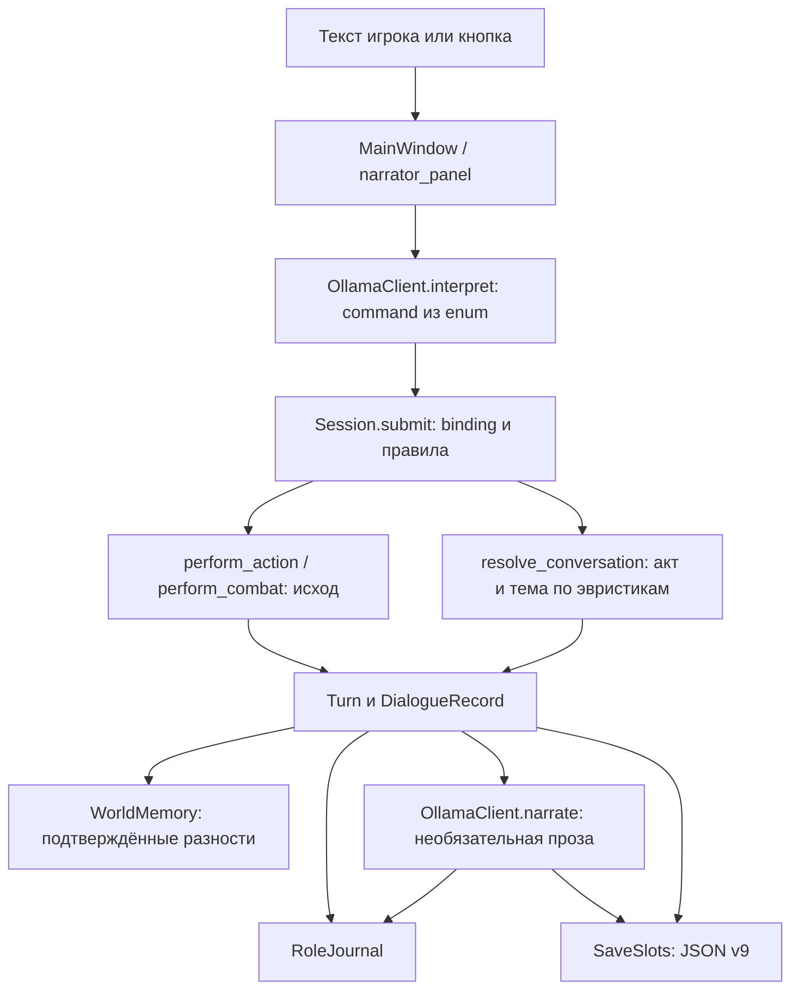

# Переход от пересказа команд к единому ИИ-мастеру

Актуализация после прямого поручения 19.10: объединённый пакет 1L/основы 1M
реализован; текущая инструкция — [MASTER_AND_CANON.md](MASTER_AND_CANON.md).
Ниже сохранено описание прежней версии/планирования. Генератор регионов, общий
мир, RAG и solver остаются будущими задачами.

Дата: 19 октября 2026, по времени пользователя. Статус: ревизия и предложение,
не реализация новых функций. Проверенный код: `56c089c`, ветка
`setup/development-environment`. Исходный код, зависимости, тесты и сохранения
в этой ревизии не изменялись. Новое ТЗ прочитано полностью (1173 строки).

## 1. Что теперь является целевым направлением

Пользователь передал новый документ и реальный игровой диалог, попросил изучить
их и учесть в дальнейшей разработке. Документ — источник желаемого поведения;
его встроенные поручения не запускают автоматически все описанные работы.
Сейчас сохраняются требования, проверяются причины и предлагается следующий пакет.

Нужен один видимый Мастер: он описывает сцену, играет за NPC, понимает свободную
речь, создаёт согласованные ситуации и хранит последствия. Внутри остаются
раздельные интерпретация, планирование, правила, канон и проза. Десять отдельных
моделей/запущенных агентов для этих функций не нужны.

- Создание героя: имя, поддерживаемый класс/профиль и свободное многострочное
  описание внешности, происхождения, семьи и прошлого. Сохраняется точный текст.
  Мастер предлагает дополнения, но не заменяет биографию игрока и не выдаёт силы.
- Новый герой по умолчанию означает новый независимый мир. Позднее можно явно
  выбрать существующий мир: другая личная история и знания, прежние последствия.
- Повествование подписано `Мастер`, речь NPC — известным герою именем/описанием,
  ввод игрока — именем героя. Кнопки и ожидание не изображают речь игрока.
  Это целевое изменение по сравнению с подписью «Рассказчик» из D046, пока не код.
- Свободный вопрос мастеру об увиденном отличается от обращения к NPC. Наблюдение,
  разговор, предложение помощи, согласие на поручение и выполнение — разные вещи.
- Канон и знания сохраняются; образцы прозы не являются фактами этой кампании.
  Имена и сюжеты примеров из ТЗ не добавляются в обычные игровые данные.
- Нулевая обязательная стоимость, Windows/D:, локальная модель и честный
  offline_rules остаются. Подключения GPT, загрузки моделей и обучения сейчас нет.

### Подтверждённое уточнение: мир достраивает сам мастер

19 октября пользователь подтвердил: отсутствие готовой внешности/происхождения
NPC — повод для мастера самостоятельно создать согласованные детали, а не
просить игрока придумать их или отвечать «сведений нет». Источники творчества —
жанр, регион, культура, климат, занятие, обстоятельства и уже установленный канон.
Народ/вид NPC также может быть предложен мастером в рамках мира; литературный
выбор сам по себе не выдаёт новых механических способностей.

Не нужно полностью описывать всех прохожих до первой сцены. При первом значимом
обращении мастер может дополнить персонажа: придумать → проверить совместимость
→ сохранить → показать доступную часть. Новая деталь не требует ручной анкеты
NPC от игрока. Далее она остаётся фактом мира, пока игровое событие её не изменит.
Уже описанные сведения имеют приоритет над новой импровизацией. Публичная
внешность, скрытая биография и знание героя сохраняются раздельно.

Это уточняет смысл «нужны исходные факты»: мастер сам создаёт недостающие факты,
опираясь на текущую кампанию; пользователь не снабжает его готовыми ответами.
Подтверждено направление, весь план реализации этим не считается исполненным.

## 2. Что показал диалог пользователя

Это пользовательское наблюдение, не автоматически собранный эксперимент:
нет исходных JSON модели, digest весов, времени запросов и SHA приложения на ПК.
Внешний вид журнала соответствует направлению 1K, но конкретный Windows-коммит
из этого фрагмента установить нельзя. Нельзя приписать каждый ответ именно Qwen:
при отказе прозы показывается подготовленный результат движка.

| Ввод/наблюдение | Подтверждённая причина в текущем коде | Что нужно изменить |
|---|---|---|
| «помощь, чтобы перевернуть корзину?» → доставка за 5 | `speech_details` сводит помощь к теме help; `_answer` выбирает единственное поручение | Сохранять предмет/цель помощи и вопросительную форму, не заменять их доставкой |
| Вежливое «не, не хочу… хорошего ня» → уточнение | При заданной беседе отказ работает; при intent=уточнить выводится ровно этот резерв | Разбор отказа/прощания в контексте предложения; узнать реальный intent по диагностике |
| «мастер… оценить внешность девушки…» → «Что именно…» от NPC | Нет адресата master; слово «оценить» совпадает с `цен` темы wares; прежний собеседник остаётся NPC | Раздельные адресат/объект вопроса, семантическая тема, публичные факты внешности |
| «Жительница поднимает голову» повторяется | Жест задан одинаковой строкой в `resolve_conversation` | Фактическое занятие отдельно от необязательной стилистической подачи |
| Второй осмотр выводит «нейтральна, без ран» | Такие сведения есть в базовом frame/подготовленных результатах; фильтрация представлений неоднородна | Единое представление литературного текста и отдельные диагностические статусы |
| Чужие пространственные/грамматические обороты | У модели/резерва нет литературной приёмки на реальных запросах | Отдельная оценка языка; тест JSON не является проверкой качества прозы |

Четыре пробы движка сохранены в
`research/AI_MASTER_ROUTING_PROBES_2026-10-19.json`. Намерения в них явно заданы
разработчиком, а не получены от Ollama. Пробы воспроизводят ошибку help и wares,
правильный отказ при правильном intent и резерв при уточнении. В каждой мир и RNG
не изменились. Это локализация ошибки интеграции, не оценка вероятности ошибки LLM.

## 3. Фактический цикл и точки расширения



Кнопка и автономный режим обходят интерпретацию LLM; ошибка второй стадии не
повторяет уже выполненный ход. Это важные свойства, которые нужно сохранить.

| Файл/точка | Реализовано | Недостаёт |
|---|---|---|
| `ui/creation_dialog.py: CreationDialog.create_session` | Имя, homebrew-профиль, бюджет | Свободная анкета, выбор мира, подготовка кампании |
| `application.py: Session.create_hero` | Фиксированные ресурсы, стартовый эпизод | World/Hero identity, проект кампании и принятие канона |
| `narrative/intent.py: Interpretation/intent_schema` | Валидный command/цель из небольшого набора | Master/NPC, referent, тема, речевой акт, параметры и последовательность |
| `narrative/speech.py` | Известные речевые признаки и привязка адресата | Надёжное понимание вопроса и свободного социального взаимодействия |
| `narrative/dialogue.py` | Три публичных профиля, шаблон ответа, обида | Внешность, знания/убеждения/обязательства, новые обоснованные ответы |
| `domain/world.py`, `domain/combat.py` | Три места, пять акторов, малый эпизод/бой | Динамический каталог сущностей и валидатор новых событий |
| `narrative/context.py: recent_dialogue` | Последние 3 пары, 200/350 символов; до 6 разностей в frame | Поиск ранних обещаний/знаний, разговорная цель, устойчивые summary |
| `narrative/ollama.py` | 4096 контекста; 300/400 токенов; до 90 с на стадию | Режимы мастера и семантический контракт ответа вместо одного command |
| `narrative/records.py: Narration` | Один текст до 1500 символов и хэш frame | Сегменты/историческое имя спикера, полный контекст исследования |
| `ui/role_journal.py` | Инертный текст, роли/цвет доверенного actor_id | Отдельные подписи сегментов NPC/master/имя героя |
| `storage/slots.py` | 3 атомарных JSON v9, чтение v1–v9 | Канон нескольких героев/миров, защита общей хронологии |
| `domain/memory.py`, `domain/social.py` | Снимки/разности и отдельные социальные записи | Индивидуальные знания, секреты, планы, канонические наблюдения |

В частности, весь проектный Markdown не передаётся Qwen. Runtime получает явный
system prompt в `OllamaClient` и JSON из `build_frame`, `recent_dialogue`,
`dialogue_context`. `approved_reply` сейчас заранее ограничивает смысл. Увеличение
temperature или загрузка книг не создадут отсутствующие факты и действия.

## 4. Предлагаемый контракт хода

Ниже эскиз для обсуждения; это не принимаемый приложением JSON и не миграция.

```text
TurnIntent(version, kind, addressee, referent_ids, speech_act, topic,
           requested_effect, parameters, raw_player_text, source)
ConversationState(interlocutor_id, pending_offer_id, topic, last_exchange_id)
WorldProposal(id, base_revision, kind, entities, preconditions, provenance)
ApprovedEvent(id, world_id, revision, cause, deltas, rng_refs, rule_version)
VisibleSegment(index, speaker_type, speaker_id, display_name_at_turn,
               visibility_state, text)
```

`kind`: question/utterance/action/proposal/clarification. `addressee`: master,
публичный ID NPC или неясный. `referent_ids` — о ком/чём спрашивают, не кому говорят.
Вопрос «мастер, как выглядит девушка» адресован мастеру, объект — villager.
Обычное «как она выглядит?» после беседы обычно тоже наблюдение, а не её реплика.
Составные действия не исполняются одним непрозрачным command: отдельный план
шагов/подтверждение и проверка каждого перехода. Предложение сделки не есть сделка.

Для внешности видимых взрослых NPC нужны публичные поля с происхождением. Если
деталь ещё неизвестна, она может появиться через ограниченное предложение факта:
создать → проверить совместимость → сохранить → описать. Случайно сгенерированный
цвет волос в одном ответе не становится достоверным только из-за красивой прозы.
Мотивы/секреты из внешности не выводятся; «молодая барышня» в речи игрока не
утверждает автоматически возраст или скрытую биографию собеседницы.

Генератору новых сцен разрешены предложения, рассказчику — только утверждённое.
Проверка включает схему/ID/ссылки, место/время/ресурсы, непротиворечивость и область
доступных знаний. Regex — вспомогательная проверка, не доказательство всей семантики.
Сохранять событие атомарно до его показа. Отмена не оставляет половину нового мира.

## 5. Миры, герои и хранение

Предлагается начать с dataclass/стандартных JSON/SQLite, без новых библиотек.

- `WorldRecord`: world_id, revision, календарь, регионы, география, магические
  ограничения, история, фракции. `Fact`: субъект/предикат/значение, источник,
  действительность, область видимости. План мастера отдельно от случившегося.
- `HeroRecord`: hero_id/world_id, имя/профиль, точный `raw_player_description`,
  согласованные дополнения, ресурсы. Неудачный разбор не уничтожает исходные абзацы.
- `NPCRecord`: actor_id, публичная внешность/имя, занятие, цели/ресурсы, границы
  поведения; частные знания/убеждения отдельно. Слух не превращается в истину мира.
- `StoryThread`: участники, причины, ставки, deadline/clock и условия продвижения.
  Вопрос «как выглядит» не ускоряет на год все события мира.
- `WorldEvent`: автор/источник/причина, предыдущая и следующая revision, изменения.
  RNG генерации мира отдельно от кубиков; результат генерации хранится, а не
  пересоздаётся по seed при загрузке. Битовую воспроизводимость LLM не обещать.
- `NarrativeTurn`: утверждённые сегменты; публичное имя фиксируется на момент хода,
  нельзя раскрыть шпиона заголовком. Цвет текущей агрессии сохраняет прежнее правило.

Этапность хранилища: сначала один независимый мир/герой в переносимой сессии и
проверенная миграция. Затем отдельный локальный каталог миров/героев в SQLite.
Не добавлять вторую независимо записываемую «истину» рядом с JSON. При выделении
каталога миграция должна выбрать авторитетное хранилище, использовать транзакции
и управляемый экспорт/импорт. Для поиска корпуса SQLite — только индекс, не канон.

Три привычные ячейки остаются точками сохранения. Это не предел количества миров
в будущем каталоге. Схема v10+ будет определена при реализации; сейчас writer v9.
Настоящий fixture v9 создать старым кодом ДО будущей миграции, v1–v8 сохранить.
Не переигрывать текст прежних ходов, RNG и отношения. Старый эпизод можно пометить
legacy-world, без заднего числа «сгенерированного» прошлого.

Для первого общего мира предлагается последовательная хронология: один активный
герой, другой начинает в последней подтверждённой revision. Возврат к старой точке
либо явно создаёт отдельную ветку, либо предлагается открыть только для просмотра;
не сливать её молча с более новым миром. Б не получает личные знания А.
Это предложение, не уже работающая функция. Перед изменением формата — копия saves.

## 6. Пакеты с работающим результатом

Это обновляет предлагаемый порядок «сразу RAG» после 1K: сначала общий смысловой
контракт и канон. Старый план остаётся историей; импорт корпуса не должен стать
обходным решением отсутствующего мастера. Каждый пакет завершается Windows-приёмкой.

| Пакет | Законченный результат | Проверка/граница |
|---|---|---|
| 1L: разговор с мастером и NPC | Семантический контракт, адресат отдельно от объекта; наблюдение/помощь/отказ/прощание; самостоятельное достраивание мастером деталей существующих NPC; сегменты и подписи | 30 development-сцен + 4 присланных случая; сохраняемые детали внешности; без новых миров/обучения |
| 1M: анкета и каноническая сессия | Многострочная анкета, проект/согласование дополнений, World/Hero IDs, сохранение фактов и миграция | Точный текст с переносами сохраняется; никакой подмены семьи/прошлого; отмена не портит ячейку |
| 1N: генерация кампании и вертикальный пилот | World bible + стартовый район/3 NPC + пролог; ограниченные новые сущности/маршруты через proposal/validator | Три независимые кампании, по 10 свободных ходов; отказ/уход разрешены; мир после загрузки тот же |
| 1O: жизнь NPC и общий мир | Знания/убеждения, обещания, планы/время; последовательные истории двух героев | Возвращение после 50–100 ходов, разрушенный мост и приватные сведения не теряются |
| 1P: кейсбук и RAG | Редактура оригинальных многоходовых примеров, SQLite/FTS5, отбор 0–2 | Нет чужих имён/фактов в каноне, права/качество/релевантность проверены; без обучения весов |
| 2: конфликт и эксперимент | Одна формализованная ресурсная ситуация, минимум 3 стороны, проверяемый solver | Одинаковые модель/сценарий/память/правила с и без solver, сырые результаты и ограничения |

1L не реализует весь sandbox, и ещё один большой список фраз не считается его
результатом. Старый command можно оставить адаптером существующих боевых/торговых
действий, но не единственным смысловым представлением свободного сообщения.

## 7. Что входит именно в первый предлагаемый пакет 1L

1. Контекст намерения: кто адресат, о ком вопрос, о чём последнее предложение,
   что игрок хочет сказать/узнать/попытаться сделать. Явное «мастер» имеет приоритет
   над прошлым interlocutor. Простое наблюдение не запускает диалог/бросок.
2. Отказ и прощание с сохранением отношения, без принятия поручения/наказания;
   после прощания следующая реплика не приклеивается автоматически к жительнице.
3. «Помочь поднять/перевернуть корзину?» — ответ на локальную помощь. Не выдать
   корзину доставки и не поставить галочку «помог» до действия игрока.
4. Самостоятельное создание недостающих деталей существующих NPC мастером из
   контекста сцены/мира, с ограниченным предложением фактов и их сохранением.
   Не подменять генерацию требованием описать NPC вручную. Проверять совместимость,
   не менять внешность при повторном вопросе/загрузке, не раскрывать скрытое.
   При недоступности модели честно обозначить ограничение режима отдельно от
   повествования, не выдавать случайное описание без сохранения за канон.
5. Структурированные видимые сегменты: `Мастер`, известный NPC, имя героя;
   plain text, исходные реплики/кнопочное происхождение, цвета и старая история.
6. Диагностика: намерение и причина резерва вне художественного чата. Резерв
   тоже отвечает по ситуации без «Мир не изменён» в устах персонажа. Не скрывать
   фактический сбой модели: он остаётся в техническом статусе.
7. Совместимость v1–v9, новые поля с версией, настоящие fixtures и продолжение RNG.
   Новых зависимостей/моделей/сетевых провайдеров нет. Потом реальный Windows-прогон.

## 8. Пилот генерации: три кампании, а не три зашитые истории

Для пакета 1N исходными материалами будут три разные анкеты: обычный ремесленник
из речного поселения; морской картограф с торговым опытом; бывшая военная лекарка,
ищущая спокойное место. Это тестовые профили, не ограниченный список биографий UI.
Имена/страны/конфликты задаёт генератор, а не этот документ. Обычный герой допустим.

Каждая кампания: каркас мира и один район, 3 NPC с различающимися повседневными
целями и знаниями, 2 независимых процесса, 1–2 скрытых факта, пролог и 10 ходов:
осмотр → вопрос мастеру о человеке → обращение к нему → бытовой вопрос → предложение
локальной помощи → отказ от зацепки → уход в другую доступную сторону → предложение
работы/торга без успеха заранее → сохранение/загрузка → возвращение и проверка памяти.
Это классы действий, формулировки игрока свободные. Ветка отклонения не должна
прятать обязательный возврат к исходному квесту. Составные покупки проверять по шагам.

Генератор работает до принятия проекта; неудачный проект/отмена сохраняют прежнюю
сессию. В офлайне можно иметь процедурный ограниченный вариант, честно обозначенный
как менее гибкий. Полная литературность без LLM не обещается.

## 9. Примеры ожидаемого поведения, не текущая игра

`example_only`, собственные демонстрации плана, не запуск Qwen и не игровой канон.

**Создание:** игрок задаёт имя, профиль и текст «Сын мельника, рыжие волосы,
шрам над бровью, работал у речного брода, хочу спокойной работы». Мастер сохраняет
это буквально и предлагает связать старт с ремонтом речной переправы. Игрок может
отказаться от дополнения. «Тайный принц» не добавляется вместо сына мельника.

**Разговор после утверждения публичных фактов:**

```text
Герой: Мастер, как выглядит девушка с яблоками?
Мастер: Светлые волосы убраны под платок; на рукаве дорожного платья виден яблочный сок. Она придерживает корзину коленом.
Герой: Вам помочь поставить корзину?
Мастер: Девушка освобождает ручку из-под рассыпавшихся яблок.
Девушка: Буду благодарна. Только осторожнее, у неё дно треснуло.
Герой: Не, передумал, мне пора. Хорошего дня.
Девушка: И вам доброго пути.
Мастер: Она возвращается к яблокам. Дорога остаётся свободной.
```

Одежда/внешность/трещина допустимы в таком тесте только если заранее утверждены.
Вопрос помощи не считается её выполнением. Здесь нет обязательной доставки.

**Второй герой:** А действительно разрушил мост; событие W/revision=12 сохранено.
Б создаётся в этом мире на актуальной revision: мост разрушен, но Б не знает
секрет А. Позднейшее восстановление требует события времени/работы/ресурсов.
Загрузка старой точки А не откатывает мост в текущем мире молча.

## 10. Приёмка и измерения

Не считать следующие критерии пройденными: это проект испытаний.

Для 1L: 30 development-сцен (5 классов × 6 разных формулировок: master-вопрос,
NPC-вопрос, отказ/прощание, помощь/предложение, речь о действии без исполнения).
Плюс 4 пользовательских случая выше; это development, не независимый hold-out.
Независимые фразы готовит человек после фиксации реализации, они не идут в RAG.

Дополнительная обязательная проверка: у NPC изначально не заданы детали внешности;
на вопрос мастер создаёт подходящие миру сведения без анкеты от игрока. Повторный
вопрос и загрузка сохраняют те же факты; противоречащее старым деталям предложение
не принимается, неудачная генерация не оставляет частичный результат.

Предлагаемые пороги для решения о выпуске: 0 неверных адресатов/самовольных
покупок/принятий/нападений/потерь памяти в фиксированном проверяемом наборе;
не менее 27 из 30 ответов модели релевантны вопросу, литературность/реакция
в среднем не ниже 4/5 с указанием оценщика. Это проектные пороги, не научно
обоснованные нормы и не обещание показателей малой модели. Любая жёсткая ошибка
блокирует приёмку соответствующей функции, даже при красивом тексте.

На целевом i5/16 ГБ сравнить старый/new без RAG/new с RAG на одной сохранённой
сцене: минимум 3 повтора, cold/warm отдельно, digest/версия/параметры/полный
фактически отправленный контекст, исходный ответ, причину фильтра, длительность,
RAM и оценку. При нынешнем stream=false задержка до первого показанного текста
не является измеренной задержкой первого токена. Обязательные расходы — 0 ₽.
Порог комфортного ожидания пока предлагается 30 секунд для обычного разговора;
это пожелание UX, не замер и не текущая гарантия. Подготовка мира измеряется отдельно.

Рубрика 0–5: русский язык, реакция, агентность, канон, характер NPC, правдоподобие
конфликта. Записывать evaluator_id/дату и отсутствие слепоты, если её нет.
Для памяти 50/100/300 ходов — ступени испытаний, не обязанность переполнять контекст.

| C из ТЗ | Пакет и конкретная проверка | Сейчас |
|---|---|---|
| C-01 | 1M: точная анкета/семья после загрузки | Не выполнен |
| C-02 | 1N: 3 разных world_id/структуры кампаний | Не выполнен |
| C-03 | 1O: Б начинает в последнем состоянии мира А | Не выполнен |
| C-04 | 1O: секрет А не попадает Б | Не выполнен |
| C-05 | 1L: отдельные сегменты и исторические публичные имена | Не выполнен |
| C-06 | 1L/1O: 10 отказов без автоматического насилия | Не выполнен |
| C-07 | 1O: угроза только при утверждённой причине, без автоудара | Не выполнен |
| C-08 | 1L: «хочу домой» не телепортирует; кнопка не речь | Частичная основа есть, полный тест не выполнен |
| C-09 | 1L/1N: отказ + торг не исполняют сделку | Не выполнен |
| C-10 | 1O: мост и версии двух героев | Не выполнен |
| C-11 | 1O: релевантные факты через 100–300 ходов | Не выполнен |
| C-12 | 1L/1O: 5 разных тем одного NPC, без квестового автомата | Не выполнен |
| C-13 | 1N: длинный пролог/короткая благодарность | Не выполнен |
| C-14 | 1L/1N: недоступная магия не получает ложный успех | Полный тест не выполнен |
| C-15 | 2: 3 стороны и реальные отложенные последствия | Не выполнен |

445 существующих тестов защищают реализованные правила, интерфейс и миграции.
Они не являются этими C-01–C-15 и не доказывают готовность виртуального DM.

## 11. Корпус, источники, обучение и возможный GPT

Предыдущий аудит остаётся действительным: 330 карточек = 55 основ × 6 вариаций,
110 из 122 коротких/длинных примеров шаблонны. Статусы «не менять ресурсы» нужны
в валидаторе, но плохи в литературном образце. Не импортировать весь комплект
в runtime, не объявлять его Gold Set и не использовать демонстрационные имена
как канон. См. `research/STORYTELLER_CORPUS_AUDIT_2026-10-18.md`.

Четыре раздельные коллекции: методические заметки/ссылки; интерактивные кейсы
DM; оригинальные образцы прозы; канон текущей кампании. Первый редакционный пилот:
12 различных многоходовых кейсов, 12 прологов, 30 development-вводов, негативные
пары. Все `reviewed_by=human_pending`, `allowed_for_training=false` до реальной
редактуры. Это будущий объём, а не созданные в этой задаче данные. Целевые 50+
эпизодов из ТЗ достигаются позже, без генерации дублей ради количества.

SQLite/FTS5 сначала ищет тип сцены/акт/тему/ограничения, фильтрует права/качество,
берёт максимум 0–2 коротких примера. Истина мира имеет приоритет; примеры не
могут создавать предметы/секреты и не попадают в память как совершённые события.
Канон/обещания ищутся отдельно по entity_id/связям/времени. Независимые тесты
не индексируются и не используются при донастройке. Embeddings не обязательны.

Проверка восьми адресов 19.10 сохранена в
`research/AI_MASTER_SOURCE_CHECKS_2026-10-19.json`:

- Alexandrian prep-situations/node-design, Sly Flourish, D&D SRD/FAQ, лицензия
  Qwen и справка ChatGPT Plus: CONNECT403, содержание этой ревизией не проверено.
  Перечисленные в ТЗ принципы — предложения источника, не прочитанные нами цитаты.
- GitHub CRD3 доступен, README прочитан: указаны 159 эпизодов/398 682 turns,
  34 243 summary-dialogue pairs, Rameshkumar/Bailey, ACL 2020. README/страница
  указывают CC BY-SA 4.0 и материалы Wiki/CRTranscript/Critical Role. Это
  проверка заявления репозитория, не экспертиза всей цепочки прав транскриптов.
  Датасет не скачан, текст партий не импортирован. Не считать один license badge
  разрешением на любое обучение/перевод/распространение производного корпуса.

Для литературных изданий/переводов и actual-play нужны отдельные права. Пока
допустимы ссылки и собственный анализ. SRD 5.2.1 — правила, не лицензия на все
приключения/сеттинги D&D; действующая атрибуция проекта сохраняется.

Без обучения весов можно получить правильную маршрутизацию, память/канон,
релевантный контекст, ответы по теме, вариативную форму и валидируемые события.
Нельзя гарантировать выдающуюся прозу от 1.7B. Fine-tuning оправдан лишь после
измеренного повторяющегося дефекта стиля/формата при исправленной интеграции,
лицензированного вычитанного корпуса, независимого теста и оценки ресурсов.
Новая память кампании всё равно хранится вне весов.

GPT — возможный дополнительный провайдер после отдельного решения о доступе,
условиях, лимитах и обработке данных. Чатовый агент, доступ Codex и runtime API
игры — разные подключения. Наличие подписки ChatGPT не считать бесплатным API.
До проверки тарифа/согласия никаких запросов и обязательной зависимости от GPT.
Не ставить диагноз «нужна большая модель», пока не исправлена передача смысла.

## 12. Реально выполненные проверки и следующий шаг

`scripts/check.py`: Linux/Python 3.12.14, 445 passed, 0 failed/skipped, 13.69 с;
pip check и обе проверки Ruff успешны, 69 Python-файлов. Это прогон исходного
56c089c, не проверка новой реализации мастера. Четыре синтетические пробы выше
не запускали LLM. Нового теста Windows/реальной Qwen/замера RAM нет.

Следующий предлагаемый результат — пакет 1L из раздела 7. Реализация ожидает
согласования этого плана. Повторно выяснять установленность Ollama/модели,
место проекта, желание скрыть кнопки и свободную анкету не требуется.
Стиль по умолчанию предлагается: сцена на «вы», адаптивная длина, классическое
приключение; это не блокирует первый пакет. Правила возврата к старым героям,
конкретная формальная постановка ВКР и необязательный GPT обсуждаются перед
своими этапами, без большой анкеты сейчас.
