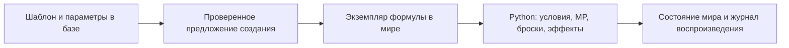

# Исходная магия с расходом MP

База хранит декларативную программу: версию, стоимость MP, способ попадания,
дальность, формулу и тип урона. Python проверяет владение формулой, состояние
героя/цели, бой, дальность и MP; затем выполняет броски и записывает результат
через обычную транзакцию игры. SQL или Python из текста модели не выполняются.

Подключение работает до обучения модели. После обучения права рассказчика
не меняются. Для формулы сначала создают экземпляр по ID и получают его обычным
игровым действием; затем мастер может предложить `library_magic` с `item` и
`target`. Источником истины о результатах остаётся движок.

## Согласованная адаптация

Ячейки заменяются MP. Базовая версионированная стоимость: заговор — 1 MP,
уровни1–9 — 4,6,8,10,12,14,16,18,20 MP. Это авторская шкала DND-NCFU,
а не число из исходного SRD. Стоимость сама по себе не означает наличия
обработчика эффекта. Известные формулы получают отдельную программу только
после реализации условий и проверок. Неизвестный уровень не превращается
в заговор автоматически. Для241заговора уровень0 восстановлен из слова
«Заговор» в закреплённом источнике.

Доступ к проверенной формуле даёт возможность её применять по правилам
DND-NCFU; исходные списки классов сохраняются как факты. Расстояния используют
геометрию текущей сцены; положение старой сцены без координат явно отмечено
scene-default/homebrew. Видимость требует сознательного, не ослеплённого
героя и не невидимой цели в текущем бою. Полная система препятствий/освещения
не объявляется реализованной этим обработчиком.

## Реализованные исходные формулы версии1

- `rpg_index_a15bd8899a1de03005856567`: «Ядовитые брызги», спасбросок
  Телосложения,10футов,1d12ядом, увеличение числа костей на5/11/17уровнях.
- `rpg_index_1035d3029310692e54d08f5d`: другая редакция того же названия,
  дальнобойная атака,30футов, те же базовые кость/масштабирование.

Обе стоят1MP за попытку. Для атаки действуют преимущества/помехи состояния,
истощение и критическое попадание; успешный спасбросок отменяет урон полностью.
Сопротивления/иммунитеты проходят общий обработчик пакетов урона.
Источники сверяются SHA256; исходная проза не включается в новые данные.
Различия редакций сохранены отдельными устойчивыми ID.

Обычные справочные записи не получают фиктивного действия. Для реализованной
записи `mechanics_state=mp-adapted`, есть типизированная `source_spell_v1`,
карточка показывает MP и способ применения. Модель видит команду и стоимость
в перечне принадлежащих герою формул. Импорт индекса сохраняет проверенную
программу при неизменной идентичности исходной записи.

## Совместимость

Аддитивная миграция008 регистрирует новые схемы/контракт. SQL001–007 не меняются.
Схема source_features_v3 восстановлена штатной сборкой с прежним опубликованным
digest; ошибка CI на пропущенной аннотации `$schema` исправлена. Сборку схем
следует выполнять через scripts/build_world_library.py, а не ручной сериализацией
промежуточного результата extend_schema. Старые Definition не переписываются.
Глобальная библиотека обновляется отдельно от сохранений пользователя.

Это первая версия исходной магии на MP, не реализация всех заклинаний.
Балансная приёмка человеком и новое обучение модели не выполнялись.
