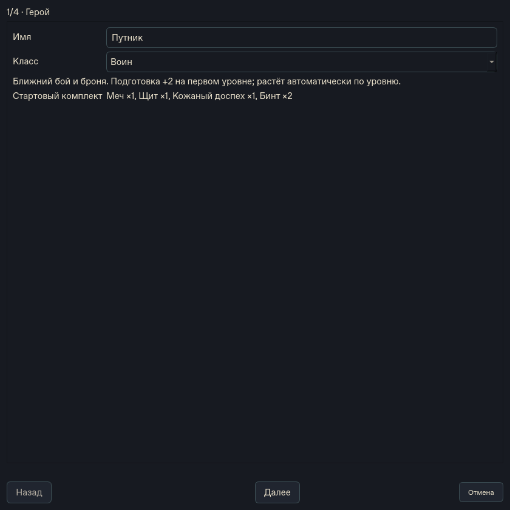
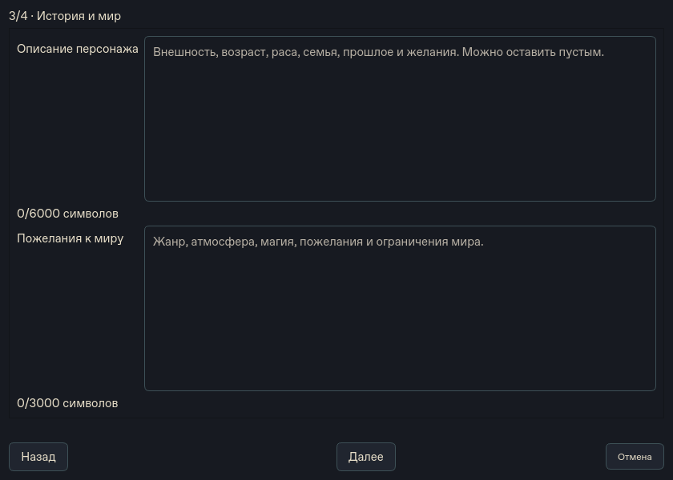
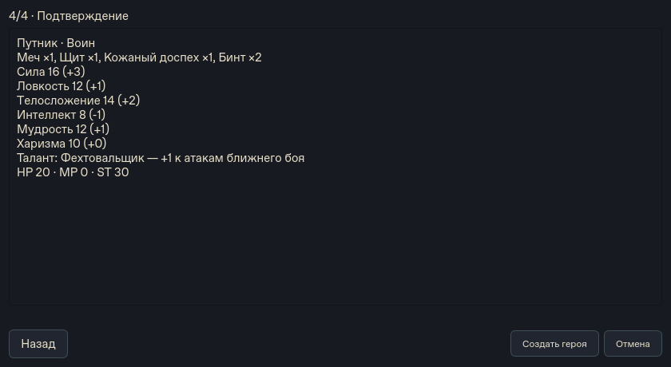
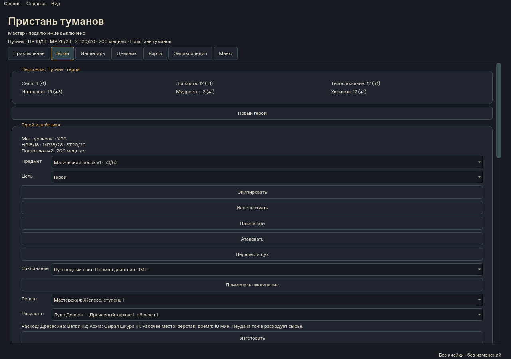
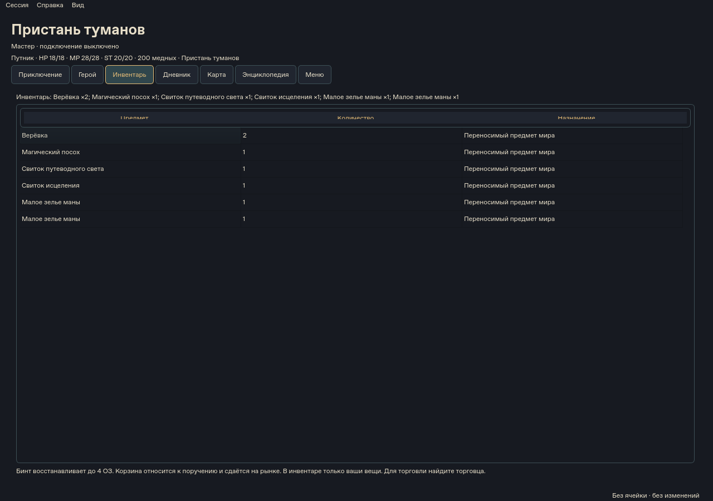
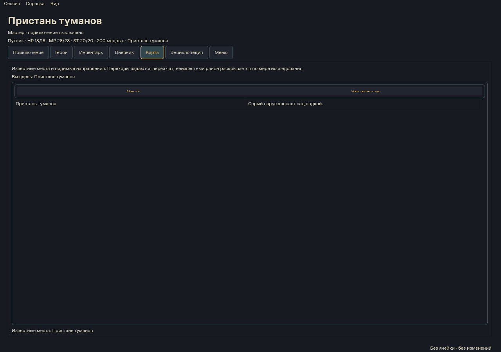
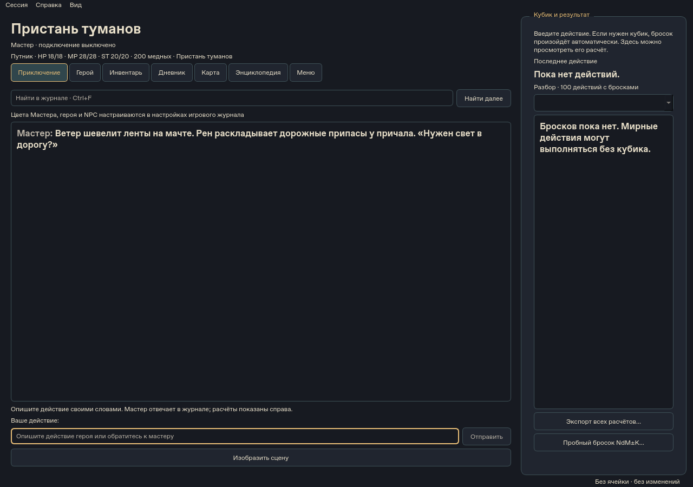

# Галерея интерфейса 0.4.0

Настоящие Qt-виджеты исходниковf033d94, снятые в Linux/offscreen, тёмная тема.
Это предварительные снимки, не Windows-приёмка. Использован авторский тестовый
город из tests/test_catalog_campaign.py, без личных кампаний и API-запросов.
Реального ответа DeepSeek на этих изображениях нет; журнал не выдаётся за живую
игру. Пример боя и входа в аккаунт отдельно не снят. Размеры/хэши — manifest.json.
Воспроизведение из dev-окружения: python scripts/capture_product_screenshots.py.
Подписи описывают экран; часть действий находится ниже видимой области прокрутки.

## Главное меню

## Имя и класс

## Характеристики и талант

## История и пожелания к миру

## Подтверждение героя

## Герой, экипировка, магия и ремесло

## Инвентарь

## Карта известных мест

## Журнал приключения

